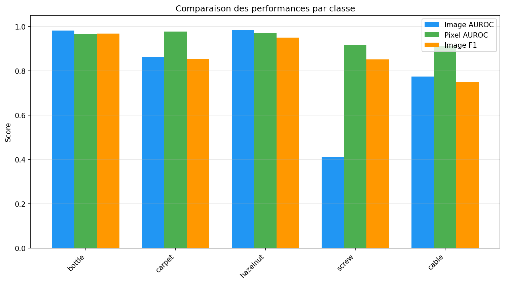

# Industrial Anomaly Detection

**Detect surface defects and visualize where an image differs from normal products.**

A frozen ImageNet-pretrained ResNet18 teacher extracts image features. A small CNN
student learns to reproduce those features using normal images. Their feature
discrepancy produces a spatial anomaly map, displayed in an interactive Streamlit app.

**Python · PyTorch · torchvision · Streamlit · scikit-learn**

## Approach

```text
Image → ResNet18 teacher ─┐
      → CNN student ─────┴→ squared feature difference → heatmap + image score
```

- Five trained categories: **bottle, cable, carpet, hazelnut and screw**.
- Images resized to 256 × 256 with ImageNet normalization.
- Image score computed from the highest-scoring 1% of heatmap pixels.
- Interactive image upload, adjustable threshold and defect overlay.

This is an **EfficientAD-inspired teacher–student experiment**, not a faithful
reimplementation of the full EfficientAD architecture.

## Recorded results



The original figure is retained without rerunning the experiments. Bottle and
hazelnut have strong image-level separation, while screw is a clear failure case.
Pixel-level localization and whole-image detection measure different behavior.

[Image ROC comparison](docs/images/roc_comparison_image.png) ·
[Pixel ROC comparison](docs/images/roc_comparison_pixel.png)

The historical evaluation chose its classification threshold on the test set.
Consequently, its F1 is exploratory and must not be described as an independently
validated operating-point result. A future experiment should select thresholds on
held-out validation data. This repository does not substitute new scores for the
recorded figures.

## Run the app

Use Python 3.11 or 3.12 from the repository root:

```bash
python -m venv .venv
```

Activate the environment (`.venv\Scripts\Activate.ps1` on Windows or
`source .venv/bin/activate` on Linux/macOS), then:

```bash
python -m pip install -r requirements.txt
python -m streamlit run app.py
```

The five trained student checkpoints are included in `models/`. Cloning the
repository provides the student weights needed for the demo. The frozen ResNet18
teacher is downloaded automatically by torchvision on first use and cached locally.
An Internet connection is therefore required for the first model load.

Upload a product image, select the corresponding category and adjust the threshold.
The app uses the **raw anomaly score**. The evaluation script additionally normalizes
scores with training statistics, so its thresholds cannot be copied directly into
the app. Scores are not defect probabilities.

## Training and evaluation

Download [MVTec AD](https://www.mvtec.com/research-teaching/datasets/mvtec-ad), then
place its category folders under `data/` as described in [the data guide](data/README.md).

```bash
python -m src.EFFICIENTAD_impl.efficientad_tests
```

Despite its historical filename, this command **trains and evaluates** the models;
it is not a unit-test command. It uses 50 epochs, batch size 16 and the five categories
listed above. Training replaces the corresponding checkpoints in `models/`; save
a copy first if you want to retain the supplied weights. New plots go to ignored `outputs/`.
The README's recorded plots remain unchanged in `docs/images/`.

## Repository contents

- `app.py`: interactive inference and heatmap visualization.
- `src/EFFICIENTAD_impl/`: teacher/student training, evaluation and plotting.
- `src/utils/`: dataset loading and category configuration.
- `docs/images/`: selected original experiment figures.
- `models/`: the five trained student checkpoints used by the app.
- `data/`: optional MVTec AD training/evaluation data, excluded from Git.

Checkpoint-format regression tests (no training or downloads):

```bash
python -m unittest discover -s tests -v
```

## References

- [MVTec AD dataset and terms](https://www.mvtec.com/research-teaching/datasets/mvtec-ad), distributed by MVTec under CC BY-NC-SA 4.0. The dataset is not redistributed here.
- [EfficientAD authors' implementation](https://github.com/nelson1425/EfficientAD), the methodological inspiration for this simplified experiment.
- [torchvision ResNet18](https://docs.pytorch.org/vision/stable/models/generated/torchvision.models.resnet18.html), used for the frozen teacher.
